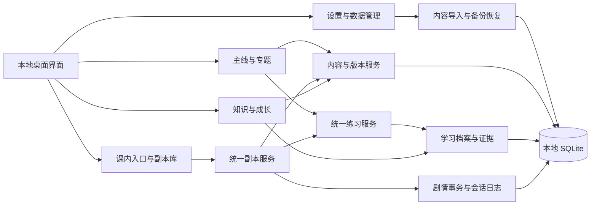

# 技术与信息架构建议

初稿日期：2026-10-13；实施更新：2026-10-14。用户本次要求沿用现有技术栈开始桌面外壳，本阶段采用 Electron + React/TypeScript + SQLite；下表保留原技术比较。已完成外壳并在当前任务接入 A1 框架骨架，详细教学与评估仍延后。

## 本地桌面技术对比

| 方案 | 对本项目的优势 | 代价与验证点 | 建议 |
| --- | --- | --- | --- |
| Electron + React/TypeScript + SQLite | Web 技术统一 UI 与应用逻辑；现有 Node 工具可作为起点；便于本地文件和桌面窗口 | 携带 Chromium/Node，包体与内存预算需实测；SQLite 驱动需适配 Electron 运行时 | 首选建议 |
| Tauri + Web UI + SQLite | 使用系统 WebView，分发时不必带完整浏览器引擎 | 需 Rust 开发环境；增加 Rust 与前端协作成本；WebView 行为需测试 | 若轻量分发优先可改选 |
| SwiftUI + Swift + SQLite | 面向 Apple 平台的原生 UI 与系统整合 | 当前 Mac 适用；后续跨到 Windows/Linux 需另做 UI；仍需验证 Xcode 编译与分发 | 若明确长期仅用 Apple 可考虑 |
| 本地浏览器 UI + 本地服务 + SQLite | 可先验证学习界面和领域逻辑 | 用户需管理服务与浏览器；端口、启动、备份和桌面分发仍要额外处理 | 可作原型，暂不建议为主要交付 |

Electron 内嵌 Chromium 与 Node；Tauri 使用系统 WebView 并要求 Rust；SwiftUI 面向 Apple 平台。依据：[Electron 简介](https://www.electronjs.org/docs/latest)、[Tauri 简介](https://v2.tauri.app/start/)、[Tauri 前置要求](https://v2.tauri.app/start/prerequisites/)、[SwiftUI](https://developer.apple.com/swiftui/)。表中维护成本和适合程度是基于当前环境与产品规模的工程判断，尚未做性能测量。

已采用 Electron 44.7.0、React 19.3.0、TypeScript 7.0.2、Vite 8.3.4、React Router 7.18.4；npm 锁定精确版本与 lockfile。esbuild 输出主进程/preload 的 CommonJS 包；@electron/packager 20.3.0 生成本机 arm64 `.app`。SQLite 使用应用运行时的 `node:sqlite`，不依赖系统 SQLite CLI，也没有另行编译原生驱动。该 API 在当前开发机 Node 24 中仍给出实验性提示，后续升级需继续做存储与 Electron 集成回归。正式签名与公证尚未完成。

## 存储建议

内容源为版本化 JSON 包，Markdown 只存讲解文本，首版优先 JSON 导入；如展示 Markdown，不允许其执行脚本。用户数据使用 SQLite。SQLite 是磁盘数据库文件，适合作为本地应用存储；参考[官方说明](https://www.sqlite.org/onefile.html)。不用浏览器缓存或 localStorage 作为唯一学习档案。

建议一个本地数据库，内部区分不可变内容版本与用户数据命名空间；正式物理表设计留到确认后。升级内容只新增版本并切换当前引用，不更新或删除旧练习；用户历史保留当时的题目、标准答案与评分规则版本。

数据库位于应用用户数据目录，不放代码仓库、构建目录或教材目录。导入先验证，再以事务写入；正式剧情的世界事实与玩家已知信息在同一用户数据事务提交。备份使用一致性快照 API 或经验证的等价方法，不直接复制正在写入的数据库；参考 [SQLite Backup API](https://www.sqlite.org/backup.html)。备份包含所引用内容版本与必要资源，不能只有孤立分数。

## 模块关系



React 渲染进程只负责展示与输入；领域层处理判分、练习历史、技能证据和副本状态；主进程持有文件与数据库能力；preload 暴露有限类型化 IPC。启用上下文隔离和渲染进程沙箱，不开放任意 SQL/文件路径接口；参考 [Electron 官方安全文档](https://www.electronjs.org/docs/latest/tutorial/security)。本地资产随应用打包，核心操作不加载 CDN 或远程脚本。

核心服务按稳定 ID 获取内容；页面不复制题型判分或副本分支逻辑。主线、拓展和副本均调用统一练习记录入口。ChatGPT 不在运行依赖图内，只提供复制任务卡与手动反馈录入。

## 信息架构

2026-10-14 外壳按用户本阶段要求将“知识/成长”拆为“知识星系”和“学习统计”，共七个一级入口；产品模块和证据原则不变。表达深化与真实文本采集同时在副本中心分类提供独立基础页面。

| 一级入口 | 最小页面与行为 |
| --- | --- |
| 首页 | 继续当前学习、真实进度、最近练习、副本库入口 |
| 课程 | 单元列表、概览、练习、检测、专题链接；DEMO 显著标识 |
| 拓展 | 框架主题列表、讲解、基础造句、课内副本 |
| 副本 | 搜索/列表、详情、玩法选择、场景、重玩、同一 ID 历史 |
| 知识/成长 | 知识列表与跳转、能力状态、表达深化集合、真实文本采集、学习档案 |
| 设置与数据管理 | 本地存储位置、内容包导入、备份导出、恢复预览、外部工具链接 |

副本详情默认简洁呈现玩法与“显示备注”开关；正式探索/练习重玩清楚标注。正式状态更新前显示待更新事实并要求一次明确确认，确认粒度暂拟场景结束。课内默认定向训练，主页可自由探索；进入方式不隐式决定是否改写正式世界。

## 拟议目录（S1 后逐步创建）

```text
DeutschLab/
├── README.md
├── docs/                    # 当前已有：基线、架构、模型、任务、决策、验收
│   └── sources/             # 当前已有：启动资料原文
├── content/
│   ├── README.md            # 当前已有：材料与导入说明
│   ├── demo/                # 后续：原创 DEMO 包，和真实内容明确区分
│   ├── packs/               # 后续：版本化课程/框架/副本内容包
│   └── private/             # 后续：私人原始教材，Git 忽略
├── src/
│   ├── main/                # 后续：窗口、SQLite 适配、文件/备份、IPC
│   ├── preload/             # 后续：有限桌面能力桥接
│   ├── renderer/            # 后续：六个导航入口与交互
│   ├── domain/              # 后续：练习、副本、内容版本、学习档案
│   └── shared/              # 后续：类型、校验与 IPC 合约
└── tests/                   # 后续：领域规则、存储与核心流程测试
```

## 当前实际分层

- `content/demo/catalog.json`：旧演示目录源；主线/副本与演示专题继续保留，旧能力占位不再用于真实 A1 能力树。
- `src/domain/catalog.ts`：按稳定 ID 获取内容，详情组件从这里查询。
- `src/renderer/`：HashRouter 路由、页面、共享组件与设计规范；支持打包后的本地文件详情地址。
- `src/shared/contracts.ts`：有限 IPC 合约、设置和浏览记录类型。
- `src/main/store.ts`：SQLite 基本设置与追加浏览足迹，拒绝非法值、未知内容 ID 和较新数据库格式。
- `src/main/index.ts` / `src/preload/index.ts`：窗口、菜单与有限 IPC；上下文隔离、沙箱、禁止新窗口与外部导航。
- `scripts/`：构建、开发、源码启动与最小应用打包。打包只复制 `dist` 和最小 manifest，不携带源码、Git、私人教材或数据库。
- `tests/`：内容引用与存储测试、真实 Electron 导航/详情/设置/布局/离线测试。

生产 HTML 使用 CSP 和本地资产，不引用 CDN。开发态仅为 Vite 热更新放开 inline 预热脚本；生产构建不保留这项放宽。

外壳阶段只保存基本设置与浏览足迹；A1 阶段的新增存储见下节。用户档案写入主进程；渲染进程无任意 SQL 或文件接口。网页预览用临时内存并明确提示，桌面存储错误不会静默降为临时模式。正式学习、版本导入、剧情事务和备份仍保留为未来服务边界。

## A1 骨架实现：v0.2.0

`content/frameworks/a1/` 保存用户原始 JSON。`src/domain/framework.ts` 校验数量、唯一 ID、来源引用、标题/顺序及目标；共享索引按 source_catalog_id 获取同一 FrameworkUnit，树和目录不会存两套专题。没有额外依赖或技术栈变更。

`src/renderer/pages/Framework.tsx` 复用 Page/Card/Badge，实现目录、板块、单元、能力树和双轴状态。`/topics` 是真实框架，`/topics/demo` 保留旧演示，`/topics/boards/:boardId` 展示板块说明，`/topics/:topicId` 展示单元。能力主题也链接这个单元地址，仍在统计页 skills 视图；其他一级页面不重构。

Schema v2 只新增目录注册、不可变修订、学习覆盖、运用记录四张表。升级与导入使用事务，不删除/清空或修改原设置、浏览表；按 catalog_id + 内容 SHA-256 幂等登记，保留旧修订。对象键顺序不影响身份，数组顺序保留。导入不写任何用户状态，缺失记录在访问时呈现默认值。

`src/domain/progress.ts` 分别读取覆盖和运用；自评/评估须有独立来源，不能从课程或浏览推出掌握。本阶段没有学习/评估写入 IPC。通用文件选择导入器、真实映射和证据采集后续开发；没有远程读取或 iCloud 同步。启动仅登记随本地资源打包的 JSON。
