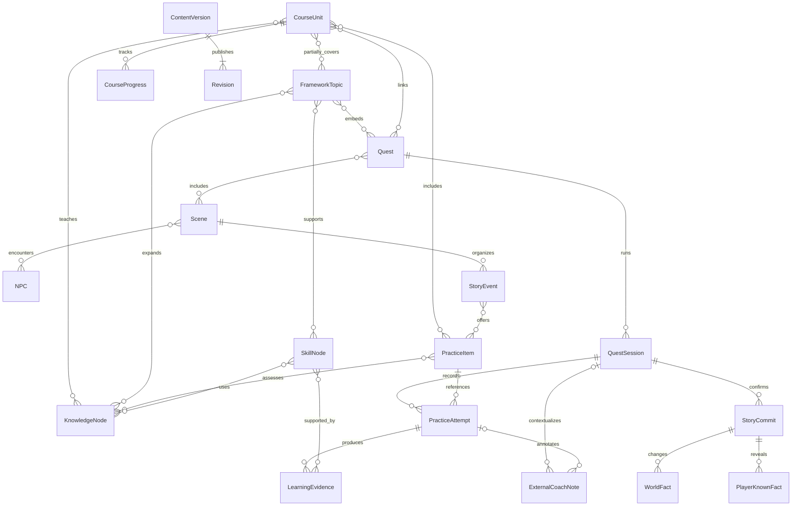

# 概念数据模型

日期：2026-10-13。状态：讨论稿。描述实体、关系和业务约束，不是物理表或迁移文件；是否合并存储、使用关系表或 JSON 字段在方案确认后决定。

## 标识与版本

内容实体使用稳定、无语义依赖的 ID，可加类型/内容包命名空间。不要用显示标题、章节序号、数组下标作为主键。示例 `demo.course.first-contact`、`demo.quest.bakery` 只是原创演示标识，不是 Studio21 章节名称。

同一实体修改时保留 ID，新增 `revision_id`；身份/教学目标实质改变则建立新 ID 并记录替代关系。用户记录用独立 UUID，记录 UTC 时间、展示时区以及引用的内容版本。备份恢复保留原 ID 以便去重。

区分内容版本 `revision_id`、内容包发布 `pack_version`、格式 `schema_version`、评分规则 `grading_rule_version`；它们不能相互代替。用户练习引用确切题目修订和包发布版本，更新后仍能重现旧反馈。内容被停用后保留历史引用版本。

## 核心实体

| 实体 | 概念标识/关键信息 | 所属与作用 |
| --- | --- | --- |
| CourseUnit | unit_id、revision_id、教材/讲义来源、原始章节标识、排序、等级、DEMO 标记 | 内容；真实主线单元，不能伪造教材标题 |
| FrameworkTopic | topic_id、revision_id、framework_id、板块、主题、等级、来源 | 内容；自学框架专题，可被多个课程部分覆盖 |
| KnowledgeNode | knowledge_id、revision_id、词汇/语法/表达类型、讲解、关联 | 内容；允许跨能力分支共享 |
| PracticeItem | item_id、revision_id、题型、题干、选项/目标约束、参考答案、判分规则及版本 | 内容；包含客观题与基础造句，标明检查范围 |
| Quest | quest_id、revision_id、主题/目标、等级、难度、场景引用、教练任务卡 | 内容；双入口调用的统一副本定义 |
| Scene | scene_id、revision_id、location_id、起始事件、可用事件 | 内容；副本中的有限情境 |
| NPC | npc_id、revision_id、人物背景、可用台词/角色知识 | 内容；可跨场景出现，也可一次性相遇，不从属于玩家 |
| StoryEvent | event_id、revision_id、NPC 台词、剧情意图分支、后继事件、候选事实变更 | 内容；剧情控制，独立关联语言训练任务 |
| WorldFact | fact_id、world_id、事实键值、来源会话/事件、提交时间 | 用户；正式世界已发生事实，不因重玩改变 |
| PlayerKnownFact | known_fact_id、world_id、player_id、知识键值、获知来源/时间 | 用户；玩家获知内容；世界事实存在不代表玩家已知 |
| PracticeAttempt | attempt_id、item/quest 引用及修订、session_id、答案、时间、反馈、判分来源 | 用户；每次真正提交语言任务追加一条历史，绝不覆盖旧成绩 |
| CourseProgress | progress_id、unit_id、未开始/已接触/已学习、关联 attempt_id、更新时间 | 用户；课程接触/学习状态，不代表能力已掌握；可作日志派生视图 |
| SkillNode | skill_id、revision_id、框架关联、交际任务目标、父子/跨分支关系 | 内容；能力定义，用户表现另存证据，不按日期硬编码状态 |
| ExternalCoachNote | note_id、attempt_id 或 session_id、摘要、来源、手动录入标记、可信度说明、时间 | 用户；外部教练建议，与客观评分和自评分开 |
| ContentVersion / Revision | revision_id、entity_id、pack_id、pack_version、内容快照/哈希、来源、变更理由、格式版本 | 内容；不可变修订及发布追溯 |

为解释规则还需要几个概念，不要求分别建表：`Location` 区分地点与场景；`QuestSession` 固定一次副本的入口、玩法、备注、正式/重玩状态与内容版本；`LearningEvidence` 区分客观判分、自评、外部建议和复测证据；`StoryCommit` 保存正式变更及确认日志。NPC 已知信息属于角色定义/剧情条件，不自动等同玩家已知信息。

表达深化可用独立 `ExpressionCollection` 组织交际意图，版本关联表达型 KnowledgeNode，并保存等级/语境/语气/语体。真实文本可用 `CapturedText` 保存原文、出处、采集时间、推荐等级、主题和使用说明。先实现最小录入/列表，不演化为庞大课程系统。

## 关系图

图仅展示核心关系；所有内容实体都引用 Revision，省略重复连线。单题以外的场景口语练习可以直接引用 quest/session，所以 PracticeAttempt 的 item 引用可为空；外部摘要可以关联单次练习或整个会话，至少一个关联上下文必须存在。

## 多对多与证据规则

CourseUnit ↔ FrameworkTopic 需要记录覆盖知识点、部分/主要覆盖和来源依据，不能只保存“关联/不关联”。两个课程可覆盖同一主题的不同部分；FrameworkTopic ↔ SkillNode 支持多条能力任务；知识点可同时服务主线、多个专题、副本和能力分支。

PracticeItem ↔ KnowledgeNode 记录考察目标；Quest ↔ FrameworkTopic、CourseUnit 的关联不复制副本定义。入口、页面路由和玩法均不进入 `quest_id` 的身份计算。同一包发布的两个入口引用同一 revision；进行中的旧会话继续固定旧版，历史按 quest_id 聚合并显示版本。

课程状态展示“已接触/已学习”；技能展示“暂无证据/待验证/能独立运用/经复测”。后两者需要明确的任务、日期、证据来源及复测关系，阈值暂未确认。客观题高分不能自动证明能独立交际；外部建议也不能直接触发“掌握”。

客观判分存规则版本与实际结果；自评存用户判断；GPT 建议存 ExternalCoachNote。未知/未评价存空值或“待评”，不能记成 0 分。语言按钮未提交答案时只记事件日志，不造一条口语准确度成绩。

## 正式剧情与重玩

会话上下文分别保存 `entry`、`play_mode`、`annotations_visible`、`story_mode`。重玩在内存/会话数据中演算分支，可记录答案和事件，但禁止写入正式 WorldFact/PlayerKnownFact。

正式探索先暂存候选变更，向用户显示将发生/获知什么，确认后用同一事务提交两类事实及 StoryCommit。确认失败或取消时全部不写；重复提交相同 commit_id 应幂等。关闭后可恢复会话，但不能把未确认草稿当正式事实。

后续内容改版不能静默改写已有世界事实；引用被停用时保留旧事实和版本，在需要时提示兼容问题。

## 导入、备份与更新

内容包有 pack_id、版本、schema_version、来源、DEMO 标志及实体/资源引用。导入必须先校验类型、重复 ID、版本冲突和悬空引用，成功后原子发布；同一 ID/修订对应不同哈希时拒绝，不覆盖。

内容包不能携带可执行迁移代码或清空用户数据的指令。用户恢复与课程导入分开：恢复先备份当前档案、显示预览，v0.1 暂拟完整档案替换式恢复，复杂合并延后；重复恢复不得产生重复 attempt_id。此策略尚待确认。

备份包含用户记录、正式状态、所引用内容快照、资源和版本清单。恢复在临时数据库校验，通过后再切换；保留原数据以便失败回退。正式 SQL 表结构、索引、迁移规则及资源封装在后续子阶段细化。

## 2026-10-14 外壳实现边界

概念模型继续保留。本阶段仅实现 `app_settings`（等级、文字大小、减少动效）和 `browsing_history`（独立 UUID、对象类型/ID、标题、UTC 浏览时间）；后者是 UI 足迹，不是 PracticeAttempt、CourseProgress 或技能证据。

浏览记录追加保存，界面读取最近 100 条，数据库不删除旧记录。内容由独立 DEMO JSON 提供，浏览保存不改变内容文件。此阶段没有内容导入器、完整 Revision 存储或学习证据表。

副本的课内/库入口仅带上下文参数，均查询 `demo.quest.bakery` 及同一修订。玩法与备注是界面预览状态；没有 QuestSession、WorldFact 或 PlayerKnownFact 写入，因此不宣称正式/重玩隔离引擎已完成。

## A1 骨架、细分覆盖与 schema v2

直接保留源 ID：板块 A1-Bxx、单元 A1-Bxx-Uxx、细分项 A1-Bxx-Uxx-Pxx；能力 SKILL-A1-…、目标 A1-Bxx-Gxx。主题通过 source_catalog_id / outline_refs 引用原目录，而不是复制内容。未来 CourseUnit 可多对多关联 OutlineItem；覆盖部分细分项不能自动完成整单元。当前 course_links 和 quest_links 全为空。

| 新表 | 身份与内容 | 导入时行为 |
| --- | --- | --- |
| framework_catalogs | catalog_id 唯一，tree_id、active_revision | 幂等登记/切换引用，不复制单元表 |
| framework_revisions | catalog_id + SHA-256 修订；两份内容快照与时间 | 新增不可变版，同版不重复，旧版保留 |
| learning_coverage | catalog_id + unit_id；覆盖状态、covered_outline_ids、时间 | 不写入/删除；缺失默认未开始 |
| ability_progress | catalog_id + 能力 node_id；运用状态、来源、证据、自评摘要、时间 | 不写入/删除；缺失默认未评估 |

运用记录不能由覆盖记录推导。自评掌握须标 source=self；有评估证据须标 source=assessment 并有独立引用。来源/引用不满足时不展示掌握。实际证据采集及完整性服务未接入，本阶段没有生成评估记录的入口。

更新目录不重写旧覆盖；若已学习单元增加未覆盖内容，当前视图呈现部分覆盖，原记录仍完整保留。未来新等级使用自己的 catalog_id，不改既有主题身份；停用实体的历史也不随目录更新删除。

## Studio21 第一单元与 schema v3

`course_content_revisions` 以 `unit_id + SHA-256` 保存不可变内容包快照；`course_content_active` 指向当前修订。`course_manual_state` 只保存用户手动标记的教材/录播状态。`card_views` 追加浏览事件；`course_position` 保存最近的卡片或练习位置。`practice_sessions` 区分小节练习和单元检测；`practice_attempts` 每次提交新增 UUID、题目/知识点 ID、答案、对错、提示/知识卡查看情况、时间、内容修订、判分规则版本及当时题目快照。

未提交答案不写入 `practice_attempts`；中途退出仍保留已提交题目，下次可继续同一未完成会话。若当前内容修订改变，新练习使用新题目，旧作答及其题目快照仍保留。上述记录不自动修改 `learning_coverage` 或 `ability_progress`。课程的 A1 专题关联只引用已存在的 `A1-Bxx-Uxx`，不推断该专题整体学完。
